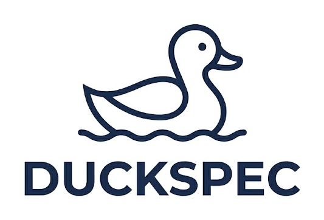

# duckspec



A spec-driven development framework for building complex projects with AI.

## How it works

1. Describe your project as YAML `@Term` files: its parts, how they connect, the behaviour it promises its users, the decisions behind it, and the rules anyone working on it follows
2. The AI moves through it with `ducktools` (a CLI and an MCP server) from the overview down — the project's parts first, then one part, then the one element the work is about, each with every rule that applies to it
3. Every change starts in the spec, and the code is then brought in line with it, so the spec keeps the whole, current picture instead of each session re-explaining it

## Concepts

| Concept | What it is |
|---|---|
| `@Term` | A named element of your project's vocabulary; one `.yaml` file per term, named after it |
| `extends` | Inheritance — a term inherits the properties, recipes and rules of its parent |
| `#`-paths | Every element has one full path that names each level: `MiruTubeApp#components#library#functions#scan` |
| `@Software` | A part of the project that is built and shipped: its components, functions, behaviour and tests |
| `@Behaviour` | A rule your software keeps toward its users, with `@Scenario` cases (given / when / then) showing where it applies; a `@Test` names the ones it checks in `verifies` |
| `@Decision` | A choice made about an element, with why and the options turned down, so a later change does not bring a rejected one back |
| `@Recipe` | Named instructions the AI executes, such as `@DuckspecProject#recipes#validate` or `@Software#recipes#build` |
| `@DuckWorkflow` | How work moves through a project, from request to release — the AI reads it to know what the change in hand needs next |
| `tracker` | Where a project's planned work and known defects are kept — its GitHub or Jira, or `@DuckTasks`, a folder of task files in the repository for a project with no tracker — so plans stay out of the spec |
| `ducktools` | The CLI and MCP server the AI reads and edits the spec through |

## Example

[MiruTube](https://github.com/komorebinator/mirutube), a video server for the home network, is written with duckspec. Its project file names what the project is for and where its parts are:

`spec/MiruTube.yaml`

```yaml
name: MiruTube
description: "MiruTube — a video server for the home network: the computer that holds the videos serves them to every other device as a site in the style of a video-hosting service, with series in order, subtitles and dubs found by themselves, videos browsers cannot play converted as they play, and every device able to see and control what plays on the others. Written with duckspec, and its worked example."
extends: "@DuckspecProject"
terms_folder: MiruTube
repository: https://github.com/komorebinator/mirutube
goals:
  - Watch any video from one computer's library on any device in the home network, with nothing to install on that device and nothing to copy first
  - Make sense of folders as people actually name them — series in order, subtitles matched to episodes — without asking anyone to rename a file
  - Start with one command, on the Python standard library and ffmpeg alone
uses:
  - https://github.com/komorebinator/duckspec
settings:
  readme: README.md
workflow:
  type: "@MiruTubeWorkflow"
software:
  - "@MiruTubeApp"
```

One thread through the application, `spec/MiruTube/MiruTubeApp.yaml`: a promise to the user, the decision behind it, the code that keeps it, and the test that checks it — each pointing to the next by its path.

```yaml
description: A video server for the home network. …
extends: "@Application"
platform: Python
components:
  - id: library
    type: Python module
    src: mirutube/library.py
    description: Turns the library folder into the catalogue — playlists, the videos in each in order, and the subtitle tracks of every video. …
    functions:
      - id: scan
        description: "… Every video and playlist gets a short id, eight letters and digits made from a hash of its path, so the same file has the same id on every scan and the link to it lasts until the file is renamed; two paths whose ids would coincide both get longer ones (decisions#short-ids). …"
  # … media, store, server, certificates, page, image, service
behaviour:
  - id: short-links
    description: Every playlist and video has a short address, `/watch/k3f9a2qd`, that can be bookmarked or sent to another device, and it keeps opening the same video after a rescan or a restart, for as long as the file keeps its name.
    scenarios:
      - id: sent
        given: an episode open on the laptop
        when: its address is opened on the phone
        then: the phone opens the same episode, at the stored position
      - id: after-restart
        given: a bookmarked episode
        when: MiruTube is restarted and a new video is copied into the library
        then: the bookmark still opens that episode
  # …
decisions:
  - id: short-ids
    description: Videos and playlists are named, in addresses and requests, by eight characters from a hash of their path within the library.
    rejected:
      - the path itself — an address several hundred characters long once encoded, and it shows the folder names to anyone it is sent to
      - a number in scan order — it changes when a file is added, and a bookmark opens another video
      - a slug from the title — long, and two releases of one show have the same title
  - id: fullscreen-here
    description: Full screen is pressed on the device that is to go full screen; the bar offers the button only on the device it acts on, and never for another device.
    rejected:
      - sending full screen to the device that plays — a browser goes full screen only within moments of a touch on its own page, so the TV refused and showed `Tap for full screen` to someone across the room with the phone in hand
      - keeping the button for another device and showing it disabled — a control that never works is noise in a bar that is already full
  # …
tests:
  - id: server
    description: against a running server on a test library — … the ids of videos and playlists are eight characters and the same after a rescan and a restart, the page is served at `/watch/<id>`, `/playlist/<id>` and `/settings`, …
    command: python -m unittest tests.test_server
    verifies:
      - behaviour#short-links
      # …
```

The spec says what the code cannot say for itself — what each part is for, what the app promises
its users and why it was built this way — and leaves to the code what the code already says: the
hash, the URL routes, the markup. The rejected options are the spec's memory: `fullscreen-here`
records a bug that shipped once, so a model asked to "let the phone put the TV in full screen"
learns why that was tried and turned down before writing it again.

## Goals

- Standardize how requirements and @Term definitions are written across projects
- Reduce the noise models introduce into the development process
- Provide tools for describing and navigating project structure
- Simplify repetitive development tasks
- Describe a system's parts, how they connect and the behaviour it promises in terms that survive a change of language, framework or platform
- Describe how a change reaches users — review, merge, release, delivery — independently of the version control, review system or tracker in use

## Commands

Every command takes a project: either a path to its `.yaml`, or the identifier of a project
registered in your workspace — so they work from any directory. Elements are named by their full
`#`-path; a path that skips a level is refused, with the full paths that fit. `ducktools help`
prints this reference from the tool itself, with the MCP tool each command corresponds to, and
`ducktools help <command>` details one command's arguments.

**Reading**

```sh
ducktools load-project Duckspec              # start here: the project's parts, terms, recipes and rules
ducktools expand Duckspec DuckToolsApp       # one part's children, each with its description
ducktools resolve-path Duckspec DuckspecProject#recipes#validate   # one element whole, with the rules that apply to it
ducktools grep Duckspec "full path"          # the elements whose text holds every word, each with its full path
ducktools load-workflow Duckspec             # how work is done in this project, step by step
```

**Understanding structure**

```sh
ducktools schema Duckspec Software           # every member, tagged with the ancestor declaring it
ducktools uses Duckspec File                 # who extends it, types by it, references it
ducktools query Duckspec --rootless          # terms declaring no extends
ducktools query Duckspec --extending Software
ducktools entries Duckspec DuckToolsApp#tests
```

**Checking**

```sh
ducktools verify-project Duckspec            # exits 1 on any error — usable as a CI gate
ducktools verify-source Duckspec             # declared source paths exist, named functions are there
```

`verify-project` finds dangling and ambiguous references, unknown or cyclic `extends`, duplicate
terms and duplicate ids, members shadowing an inherited one, and entries setting fields no type
declares. It checks that what is written is true and consistent — not that everything was written.

**Editing** — on the example above, kept in a project registered as `MiruTube`

```sh
ducktools set MiruTube MiruTubeApp#components#library description "..."
ducktools edit MiruTube MiruTubeApp#components#library description "old words" "new words"
ducktools remove MiruTube MiruTubeApp#decisions#fullscreen-here
ducktools batch MiruTube edits.json           # several edits, all or nothing
```

Every edit addresses one element by its full path, so it cannot land on whichever element happened
to come first. Any command that refuses — a path not found, an edit that cannot apply — exits 1.

**Tasks** — for a project whose workflow names `@DuckTasks` as its tracker

```sh
ducktools list-tasks MyProject               # open tasks, in progress first
ducktools create-task MyProject drop-zones title="Drop zones" kind=plan description="..."
ducktools comment-task MyProject drop-zones "Found: ..."   # a dated detail, as a comment
ducktools close-task MyProject drop-zones    # deletes the file; git keeps what was done
```

**Workspace**

```sh
ducktools list-projects
ducktools add-project ./MyProject.yaml
ducktools create-workspace side-project
ducktools use-workspace side-project
```

## Installation

duckspec is installed once per machine, not per project. Copy and send to your AI assistant:

> Install duckspec on this machine by following the `install` recipe in https://github.com/komorebinator/duckspec/blob/main/Duckspec.yaml

The assistant clones the framework into a folder you choose, sets up `ducktools` (and its MCP
server, if your assistant supports MCP), then asks whether to bring one of your existing projects
under duckspec or start a new one.
